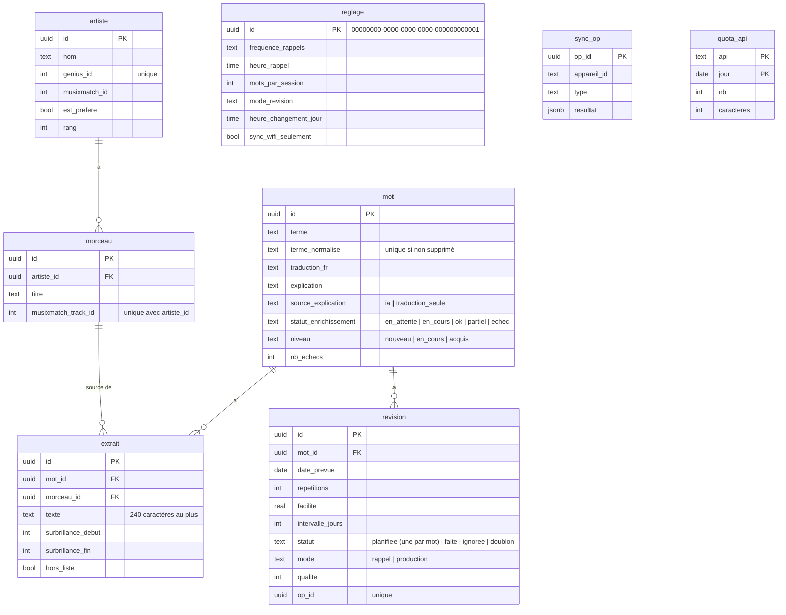

# Schéma de la base (DOC-03)

Généré depuis la migration `0001` (`backend/migrations/versions/0001_schema_initial.py`). Les tables marquées « sync » portent `created_at`, `updated_at`, `deleted_at` et `server_seq`, posés par le déclencheur `fn_sync_stamp` à partir de la séquence `seq_sync`.

Tables synchronisées : `mot`, `artiste`, `extrait`, `revision`, `reglage`. Tables locales au serveur : `morceau`, `sync_op`, `quota_api`.
